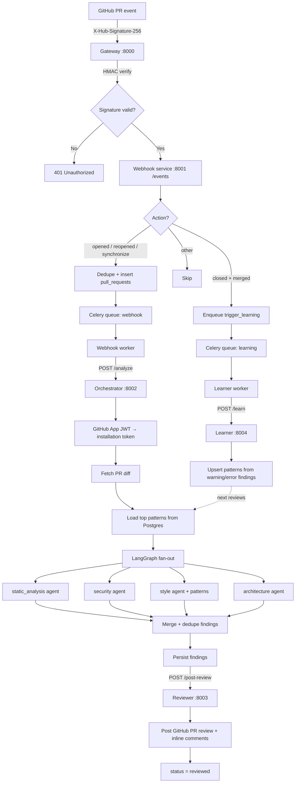

# Monk

**Monk** is an AI-powered GitHub code review platform. It watches pull requests on repositories where a GitHub App is installed, runs a multi-agent LLM analysis on each diff, posts structured review comments back to GitHub, and continuously learns recurring issue patterns so future reviews get sharper over time.

It is built as a distributed system: thin edge services for webhook intake, async workers for fan-out, a LangGraph orchestrator that runs specialized review agents in parallel, a reviewer that talks to the GitHub API, and a learner that turns merged-PR findings into repo-specific memory.

---

## Why it exists

Manual code review does not scale. Static linters catch syntax and style, but miss security paths, architectural coupling, and team-specific smells. Monk sits in the middle:

- **Event-driven** — reacts to GitHub PR webhooks (`opened`, `reopened`, `synchronize`, `closed`/`merged`)
- **Multi-agent** — four specialized reviewers (static analysis, security, style, architecture) run in parallel on the same diff
- **Feedback-aware** — when a PR merges, high-severity findings are upserted into a per-repo pattern store and fed into later style reviews
- **Production-shaped** — FastAPI microservices, Celery + Redis queues, PostgreSQL, Kubernetes on AWS EKS, Prometheus metrics, Langfuse tracing, and Ragas evaluation

---

## Tech stack

| Layer | Choices |
| --- | --- |
| **Languages / runtime** | Python 3.11, FastAPI, Uvicorn |
| **AI / orchestration** | LangGraph (fan-out / merge graph), OpenAI-compatible client via xAI Grok (`grok-build-0.1`), Langfuse instrumentation |
| **Async jobs** | Celery workers, Redis broker (AWS ElastiCache) |
| **Data** | PostgreSQL 15 (RDS), SQLAlchemy async + asyncpg, Alembic migrations |
| **Auth / GitHub** | GitHub App (JWT → installation tokens), HMAC-SHA256 webhook verification |
| **Observability** | Prometheus FastAPI instrumentator, Grafana dashboards, Langfuse |
| **Quality gate** | Ragas (`faithfulness`, `answer_relevance`) over recent findings |
| **Infra** | Terraform (VPC, EKS 1.32, RDS, ElastiCache, ECR, S3), Kubernetes manifests (Deployments, Jobs, Ingress ALB, HPA) |
| **CI/CD** | GitHub Actions → ECR build/push → `kubectl set image` on EKS |

---

## Repository layout

```
monk/
├── services/
│   ├── gateway/        # Public webhook edge (HMAC verify → forward)
│   ├── webhook/        # Event ingest, PR persistence, Celery enqueue
│   ├── orchestrator/   # Diff fetch + LangGraph multi-agent review
│   ├── reviewer/       # Posts GitHub PR review + inline comments
│   └── learner/        # Pattern extraction from merged PRs
├── db/migrations/      # Alembic schema (pull_requests, findings, patterns)
├── scripts/            # Offline Ragas evaluation job
├── infra/
│   ├── terraform/      # AWS networking, EKS, RDS, Redis, ECR
│   └── k8s/            # Deployments, workers, Ingress, HPA, Jobs
├── monitoring/         # Prometheus scrape config + Grafana dashboard
└── .github/workflows/  # Per-service CI/CD + reusable pipeline
```

---

## Architecture complexity (with examples)

Monk looks simple from the outside (“comment on my PR”), but the path from webhook to GitHub review crosses several concerns. Concrete examples of that complexity:

### 1. Gateway — trust boundary

`services/gateway` is the only internet-facing service (ALB Ingress → port `8000`).

- Verifies `X-Hub-Signature-256` with HMAC-SHA256 against `GITHUB_WEBHOOK_SECRET`
- Rejects forged payloads with `401`
- Forwards the raw body to the internal webhook service — no business logic at the edge

**Example:** A forged `pull_request.opened` event without a valid signature never reaches the database or LLM pipeline.

### 2. Webhook service + worker — durable intake

`services/webhook` accepts `/events`, decides what to do, and hands work to Celery:

| GitHub action | Behavior |
| --- | --- |
| `opened` / `reopened` / `synchronize` | Deduplicate on `(repo, pr_number, head_sha)`, insert `pull_requests` row (`status=pending`), enqueue `analyze_pr` on the `webhook` queue |
| `closed` + `merged` | Look up the PR and enqueue `trigger_learning` on the `learning` queue |
| Anything else | Return `{status: "skipped"}` |

**Example:** Pushing three commits quickly produces three `synchronize` events with different SHAs. Each SHA gets its own row and analysis job; a duplicate delivery of the same SHA returns `already_processing`.

The Celery worker then HTTP-calls the orchestrator (`POST /analyze`) so the FastAPI process stays responsive under bursty webhook traffic.

### 3. Orchestrator — parallel multi-agent graph

`services/orchestrator` is the heaviest component. On `/analyze` it:

1. Mints a short-lived GitHub App JWT and exchanges it for an **installation token**
2. Fetches the PR **diff** (`Accept: application/vnd.github.v3.diff`)
3. Loads the top-10 most frequent **patterns** for that repo from Postgres
4. Invokes a **LangGraph** compiled graph that fans out to four agents, then merges

```
                    ┌──────────────────┐
                    │  fan_out (Send)  │
                    └────────┬─────────┘
           ┌─────────┬───────┼───────┬─────────┐
           ▼         ▼       ▼       ▼         │
   static_analysis  security style architecture│
           │         │       │       │         │
           └─────────┴───────┼───────┘         │
                             ▼                 │
                          merge ───────────────┘
                             │
                            END
```

Each agent node calls Grok with a specialized system prompt and must return a JSON array of `{file, line, severity, message}`. The merge node deduplicates by `(file, line, agent, message)`. Findings are persisted, then handed to the reviewer.

**Example complexity:**
- A SQL string built from request input may be flagged by **security** (injection) while the same function’s nesting depth is flagged by **static_analysis** — two agents, two findings, one merge.
- The **style** agent’s prompt is dynamic: it injects learned team patterns (“prefer early returns”, “don’t log PII”) so reviews adapt per repository.

### 4. Reviewer — GitHub API write path

`services/reviewer` receives findings and posts a PR review:

- Builds a markdown summary (`## AI Code Review`) plus **inline comments** on the RIGHT side of the diff
- Falls back to a summary-only review if GitHub returns `422` (line not in the diff hunk)
- Updates `pull_requests.status` → `reviewed`

**Example:** A finding on `app/auth.py:42` becomes an inline comment; a finding with a bad line number still appears in the summary so nothing is silently dropped.

### 5. Learner — closed-loop memory

When a PR merges, the learner loads findings with severity `warning` or `error` and upserts them into `patterns` with `ON CONFLICT … frequency = frequency + 1`.

**Example:** After five merges that all flagged “missing timeout on external HTTP client”, that pattern rises in frequency ranking and surfaces in the next orchestrator run’s style context.

### 6. Data model

| Table | Role |
| --- | --- |
| `pull_requests` | Idempotent PR work items (`repo`, `pr_number`, `head_sha`, `installation_id`, `status`) |
| `findings` | Per-agent review output tied to a PR |
| `patterns` | Repo-scoped recurring issues with frequency counters |

### 7. Infra & ops surface

Complexity continues past application code:

- **Terraform** provisions VPC, EKS, RDS Postgres, ElastiCache Redis, ECR repos, and an S3 reports bucket
- **K8s** runs API deployments plus dedicated **webhook-worker** and **learner-worker** pods; orchestrator has an HPA (2–6 replicas @ 70% CPU)
- **Migration Job** applies Alembic before traffic
- **Evaluate Job** runs Ragas offline and can fail the pipeline if mean faithfulness &lt; 0.7
- **Prometheus** scrapes `/metrics` on ports `8000`–`8004`

---

## End-to-end process flowchart



---

## Service ports

| Service | Port | Responsibility |
| --- | --- | --- |
| Gateway | `8000` | Public webhook receiver |
| Webhook | `8001` | Event routing + enqueue |
| Orchestrator | `8002` | Diff analysis graph |
| Reviewer | `8003` | GitHub review posting |
| Learner | `8004` | Pattern learning |

---

## Data flow summary

1. **Ingress** — GitHub hits the ALB → Gateway verifies the signature.
2. **Persist & queue** — Webhook records the PR and enqueues analysis (or learning on merge).
3. **Analyze** — Orchestrator authenticates as the GitHub App, pulls the diff, runs four agents in parallel via LangGraph, stores findings.
4. **Publish** — Reviewer writes a PR review (summary + inline comments) and marks the PR reviewed.
5. **Learn** — On merge, Learner promotes serious findings into repo patterns used by future style reviews.
6. **Observe & evaluate** — Prometheus/Grafana for runtime; Langfuse for LLM traces; Ragas job for answer quality gates.

---

## Local / cluster notes

- Configuration is injected via Kubernetes `ConfigMap` / `Secret` (database URL, Redis URL, GitHub App credentials, Grok/Langfuse keys).
- Workers are separate Deployments (`webhook-worker`, `learner-worker`) so API pods and Celery consumers scale independently.
- CI builds each service image to ECR and rolls the matching Deployment on `main`.

---

## License

Proprietary / private — update this section if the project is open-sourced.
